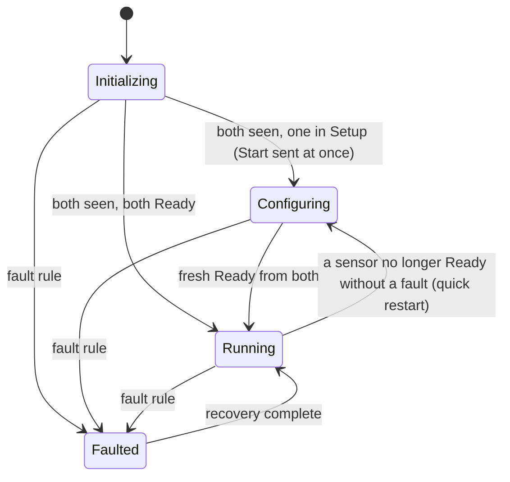

# Design

This document explains the backend's structure, the assumptions made where the task leaves room,
and the decisions taken. Requirements come from
[`Developer-Sensor-Task.md`](simulators/Developer-Sensor-Task.md) and
[`PROTOCOL.md`](simulators/PROTOCOL.md).

## 1. Overview

```
 Camera sim (UDP 8100) ─┐                                   ┌─> GET /api/status   (JSON snapshot)
                        ├─> UDP 7450 ── one socket ── backend ┼─> GET /api/events   (SSE, ≤ 20/s)
 Pointer sim (UDP 8200) ┘   receives data, sends commands    └─> /  (static UI),  /swagger
```

One ASP.NET Core process hosts everything. The backend logic lives in two class libraries, so it is
testable without the web host:

| Project | Responsibility |
|---|---|
| `Sensor.Communication` | Packet model, `SensorPacketDecoder` (all byte-level validation), `SensorPacketEncoder`, `IDatagramTransport` + `UdpDatagramTransport` |
| `Sensor.Control` | `SensorControl` (one per sensor: session, sequence, freshness, commands), `SystemSupervisor` (state machine), `SupervisorEventLoop`, pairing and processing, status snapshot |
| `Sensor.WebApi` | Composition root, configuration, hosted service, minimal API endpoints, OpenAPI/Swagger, static UI |

Only official Microsoft packages are used, plus `Swashbuckle.AspNetCore.SwaggerUI` for the Swagger
page. The UI is plain HTML/JS/CSS with no build step.

## 2. Threading model: a single event loop

```
 receive loop ──(decoded packet)──┐
                                  ├──> Channel (bounded, 1024) ──> single consumer ──> SystemSupervisor
 PeriodicTimer 50 ms ──(tick)─────┘                                                     ├─ SensorControl × 2
                                                                                         ├─ MeasurementPairer ──> ProcessingWorker (own task)
                                                                                         └─ SystemStatusStore (immutable snapshot)
```

- All sensor and system state is changed by **one consumer, strictly in order**. No locks are needed
  in `SensorControl` or `SystemSupervisor`, and transitions are deterministic and easy to test.
- The receive loop decodes into **one reused 64 KB buffer** (larger than any datagram, so oversized
  datagrams are rejected by length instead of being truncated). Only Camera images are copied out,
  because they must outlive the buffer.
- The 50 ms tick drives the 1 s silence check (detected within 1.00–1.05 s) and Start retries.
- HTTP threads never touch that state. After each event the loop publishes an **immutable
  `SystemStatus` snapshot** (an atomic reference swap); the API reads only snapshots, plus the
  worker's thread-safe latest result.
- Time is always the monotonic `TimeProvider` (a fake clock in unit tests), never wall-clock time.

## 3. Protocol handling

**Byte-level validation** (`SensorPacketDecoder`, stateless). It rejects, with a logged reason:
truncated datagrams or trailing bytes (exact length = header + declared length), wrong magic,
version, message type, sensor ID or reserved flags, zero session or sequence, a payload length that
is wrong for the type and sensor, unknown state or command, coordinates outside 0..9, and alpha ≠ 255.

**Stateful validation** (`SensorControl.Accept`), in this order:

1. Command packets are never accepted from sensors.
2. The source endpoint must be the sensor's configured endpoint, **and** the sensor ID must match.
3. Session: the current session is accepted; a **retired** session is rejected; any other ID is a
   **new boot**. The old session is retired, and the output sequence, reported state, command
   counter and cached measurement are all reset. The last 32 retired IDs are remembered: restarts
   are rare, late packets only arrive for milliseconds, and the memory stays bounded.
4. Sequence: heartbeats and measurements share one counter, so only **strictly newer** packets are
   accepted. Duplicates and reordered older packets are rejected. Gaps are fine.

A rejected packet changes nothing: not the state, and not freshness. Only valid traffic of the
current session refreshes "last valid traffic".

**Commands.** `SendCommandAsync` uses the sensor's current session ID and the sequence
`max(our last command, the sensor's reported last accepted command) + 1`. So it starts at 1 for a new
session and continues correctly after a backend restart. A retry is always a new, higher sequence.
Send failures are logged, the sequence is still consumed, and the system state is unaffected.

**Windows.** An ICMP "port unreachable" (e.g. a command sent to a stopped sensor) would otherwise
surface as `ConnectionReset` on the next receive of the shared socket. The transport disables it
(`SIO_UDP_CONNRESET`) and also tolerates it.

## 4. System state machine (`SystemSupervisor`)



After every accepted packet and every tick, the **fault rule** is evaluated first (in every state, with
priority), then the current state's rule:

| State | Behavior |
|---|---|
| Initializing | Listen only, **no commands**, no timeout for an unseen sensor. "Seen" means a **state was reported** (a heartbeat); a measurement alone does not decide Ready/Setup. |
| Configuring | Send Start to every sensor reporting Setup. Retry while it keeps reporting Setup, at most every 500 ms, each retry a new sequence. Running requires a Ready heartbeat from both **received after entering Configuring** ("fresh"). |
| Running | Process measurements. If a sensor stops being Ready without a fault (a restart faster than 1 s, so its new session reports Setup), go back to Configuring and start it. |
| Faulted | See below. Never goes to Configuring. |

**Fault rule.** A sensor reporting **Error** faults immediately. A sensor whose latest accepted state is
**Ready** with no valid traffic for **≥ 1 s** faults. Silence in Setup or Error, or from a never-seen
sensor, is not a fault.

**Fault episode.**

- **On entering Faulted:** processing stops. If exactly one sensor is faulted (sensor-specific), a
  best-effort **Stop is sent to the other sensor once per episode**. If the other sensor was never
  seen, Stop cannot be addressed (its session is unknown); this is logged. Repeated reports of the
  same fault send nothing. A second sensor faulting during the episode extends it, without a new Stop.
- **Recovery (automatic):**
  1. A faulted sensor that reports **Setup after the fault** (cleared, or restarted) gets Start.
     Start is never sent to a sensor reporting Error, so it cannot "clear" an Error.
  2. Once **all faulted sensors report Ready after the fault**, the other sensor gets Start if it
     reports Setup. That's the stopped peer, or a sensor first seen during the fault (the unseen
     sensor is not dropped from recovery).
  3. **Running** when both sensors report Ready after the fault.
- **Decision:** a sensor that faulted by silence and comes back **still Ready** (connectivity
  restored, never restarted) counts as recovered on a fresh Ready heartbeat. The task's wording is
  "connected and report Ready", and forcing a Stop/Start cycle would add commands without benefit.
- **Start retry throttling** only counts Starts sent during the sensor's **current** Setup period.
  An earlier Start (e.g. from Configuring, just before a fault) never delays recovery.

## 5. Pairing rule (which image goes with which position)

The streams are unsynchronized: Camera 50 Hz (every 20 ms), Pointer 10 Hz (every 100 ms). Sensors send
no timestamps, so freshness uses the **backend's receive time** (monotonic).

| Question | Rule |
|---|---|
| What triggers a calculation? | Each new **Pointer** sample (the slower stream). That gives one result per position (~10/s), and no recalculations of an old position against newer images, which matters because the production algorithm is expensive. Images only update the cache. |
| Which image? | The **latest Camera image received before** that Pointer sample. |
| When is an image too old? | If it was received more than **50 ms** before the Pointer sample (`Pairing:MaxImageAge`). That is about 2.5 image intervals: one lost image plus jitter is tolerated. The sample is then skipped (counted as "stale image"), and the last result stays on screen with its age. |
| One stream newer than the other? | An image arriving **after** the Pointer sample is not used for it (it only serves the next sample). If the Pointer stream stops, nothing is recalculated; an old position is never shown on a new image. |
| No image yet? | The sample is skipped (counted as "no image"), e.g. the first position right after entering Running. |
| Older session? | Retired-session packets are rejected before pairing. The pairing cache is only filled **while Running** and is **cleared whenever the system leaves Running** (a sensor restart always leaves Running). So a pair never mixes sessions, and packets in flight after a Stop or fault are never paired in a later run. |
| Duplicates / reordering? | Rejected by the sequence check before pairing. |

Raw data for the UI is separate: `SensorControl.LatestMeasurement` keeps the latest raw image and
position of the current session **in every state**, so the UI shows live images even while Configuring.

## 6. Processing model

The task notes that the production algorithm is expensive. So:

- `IMeasurementProcessor.ProcessAsync(image, position, ct)` is a **Strategy**. `PixelLookupProcessor`
  is today's implementation; it returns the RGBA bytes at `4 * (10y + x)` and completes synchronously
  without allocating.
- `ProcessingWorker` runs it **off the event loop**, one pair at a time, with **latest-wins** queuing (a
  channel of capacity 1 that drops the oldest pair). A slow algorithm therefore never builds a
  backlog (memory stays flat and results stay current), and never delays heartbeat handling (no
  false silence faults).
- **Leaving Running** calls `Reset()`. It drops the waiting pair, **cancels** the computation in
  progress, and discards any result that still completes (via an epoch counter). This is "stop
  processing" on a fault. The last published result stays visible, marked with its age.
- If parallel computation is ever needed, it can be added behind the same interfaces.

## 7. Web API and UI

- `GET /api/status`: system state, fault reason, each sensor's state, **connection status**, session
  and last-seen age, the latest raw image (Base64 RGBA, 400 bytes) and position, the latest result
  (color, the **image and position used**, pairing skew, age), and counters.
- `GET /api/events`: Server-Sent Events (`TypedResults.ServerSentEvents`, browser `EventSource`). The
  first event is sent immediately, then every 50 ms **only if something changed**. That's at most
  20 updates/s, which bounds browser load (the Camera alone produces 50 images/s).
- **Connection status** (the task does not define it): *NeverSeen*; *Connected* if there was valid
  traffic within the silence timeout (1 s); otherwise *Disconnected*.
- OpenAPI (`/openapi/v1.json`, built-in generator) and Swagger UI (`/swagger`) are always enabled
  (local, trusted-network exercise). Enums are serialized as strings.
- The UI (`wwwroot`) draws both images on a `<canvas>` with the pointer pixel outlined, and shows the
  color as a swatch plus R, G, B, A values.

## 8. Simulator change

The supplied simulators exit on Windows when a heartbeat is sent while nothing listens on 7450 (the
same ICMP reset as above, unhandled). The repository copy has one fix,
`SimulatorApp.DisableUdpConnectionReset`, so the start order does not matter and a backend restart
does not kill them. Nothing else was changed. The backend does not rely on this fix: with the
original simulators, start the backend first.

## 9. Testing

| Level | What | How |
|---|---|---|
| Unit | Decoder/encoder (all PROTOCOL.md examples byte-for-byte, every rejection reason), `CameraImage`, `SensorControl`, `SystemSupervisor` (one scenario per task rule), pairing rule edges, worker (latest wins, reset/cancel/discard), status store | Fake transport + `FakeTimeProvider`: deterministic, no sleeps |
| Integration | UDP transport over loopback, event-loop wiring | Real sockets / real loops |
| Endpoint | `/api/status`, `/api/events`, UI, OpenAPI, Swagger | `WebApplicationFactory` (UDP on port 0) |
| End-to-end | Startup with exact color check; single sensor; Error fault + recovery; Ready-silence fault + recovery; Setup silence; sensor restart | Real host + protocol-faithful simulated sensors over UDP |

`dotnet test Sensors.slnx` runs all of them (~10 s).

## 10. Assumptions and limitations

- Trusted network, as stated by the protocol: no authentication; endpoint and session checks only.
- Sensor endpoints are configured (IP literals), not discovered.
- State is in memory only: no persistence or history (not required by the task).
- The 50 ms max image age, 500 ms Start retry and 50 ms tick are design choices, all configurable.
- The fault reason lists every sensor in the current episode, e.g. `Camera reported Error; Pointer silent while Ready`.

## 11. Decision log

Decisions made by the author during design, with the options considered. The process is described in
[`DEVELOPMENT-PROCESS.md`](DEVELOPMENT-PROCESS.md).

| # | Topic | Options considered | Decision | Why |
|---|---|---|---|---|
| 1 | Solution structure | Per-layer DLLs; one project; libraries + host | `Sensor.Communication`, `Sensor.Control`, `Sensor.WebApi`, `Sensor.Tests` in one solution, with the simulators alongside | Separation where it helps testing, without per-layer project overhead. Names are not "Backend"-specific, because protocol and transport are shared concepts. One repository, as the assignment expects. |
| 2 | Abstractions | Interfaces for every layer; a sensor-side `ISensor` hierarchy; a generic scenario engine; none | `IDatagramTransport` (test seam), stateless codec classes, `SensorControl` per sensor; no sensor-side hierarchy or scenario engine | An interface needs a reason (a test double or a real alternative). The only real "scenario" is the system state machine. |
| 3 | Naming of the per-sensor class | `RemoteSensor`, `SensorRemote`, `SensorControl`, `SensorController` | `SensorControl` | It controls a sensor rather than being one. "Controller" would clash with ASP.NET naming. |
| 4 | Simulators | Keep unchanged; refactor onto the shared library | Keep unchanged, later with **one** isolated Windows fix (#15) | They are the reference the system is evaluated with. Refactoring was out of scope and risky. |
| 5 | Packet model | Structs (fewer allocations); record classes | Sealed **records** for packets (`SensorPacket` hierarchy), **readonly record structs** for header, position, color | A type hierarchy enables pattern matching and one decode result. A struct would not avoid the image allocation anyway; at ~60 packets/s the saving is negligible. |
| 6 | Receive API | `UdpClient.ReceiveAsync` (new array per datagram); `Socket` + reused buffer | `Socket.ReceiveFromAsync` into one reused buffer, returning `ValueTask` | No per-packet allocation on the hot path, at no design cost. |
| 7 | Threading | Locks around shared state; a single event loop | **Single event loop** (`Channel`; receive loop + timer tick; one consumer) | No locks, deterministic ordering, and easy to test. One channel hop per packet is negligible. |
| 8 | Pairing trigger | Pointer-driven; Camera-driven (5× more work); closest-timestamp matching | **Pointer-driven**, latest prior image | One result per position. It avoids recomputing an old position against new images, which matters because the algorithm is expensive. |
| 9 | Max image age | 20 ms (nominal interval); 50 ms; 100 ms | **50 ms**, configurable | Tolerates one lost image plus UDP and OS jitter. |
| 10 | Processing concurrency | Queue every pair; parallel computations with "newest result wins"; one at a time with latest wins | **One computation at a time, latest wins**, parallel later behind the same interface if needed | Bounded CPU and memory, always-current results, results never out of order. |
| 11 | Processor interface | Synchronous; `ValueTask` + cancellation | `ValueTask<RgbaColor> ProcessAsync(..., ct)` | Allows cancelling an expensive computation and future async algorithms, at no cost to the synchronous lookup. |
| 12 | On leaving Running | Drop the waiting pair only; also cancel the in-flight computation and discard late results | **Cancel and discard** | Strictly "stop processing"; nothing from an old run appears late. |
| 13 | Silence-faulted sensor returning in Ready | Accept a fresh Ready; force Stop → Setup → Start | **Accept a fresh Ready** | Matches "connected and report Ready"; simpler, with fewer commands. |
| 14 | Quick restart while Running (no silence fault) | Undefined by the task | **Running → Configuring**, Start the new session | The new session reports Setup, so the system is no longer "both Ready". |
| 15 | Simulators exiting on Windows | Document a start order only; fix the simulators | Apply one isolated fix (`DisableUdpConnectionReset`) + Visual Studio multi-start profile | Lets all projects start together safely; the backend still works with the originals (documented). |
| 16 | Start retry / tick | — | 500 ms retry (2 heartbeats), 50 ms tick | Recovers a lost Start quickly without flooding; silence detected within 1.00–1.05 s. |
| 17 | Persistence | Database / repositories / cache; in memory | **In memory only**, logs via `ILogger` | Not required by the task; no repositories without a database. |
| 18 | Live UI transport | SignalR (two-way, needs a JS client library); polling (latency, wasted requests); SSE | **Server-Sent Events** | One-way server → browser is all that is needed. Built into .NET 10 and browsers, no packages, auto-reconnect. |
| 19 | SSE push rate | Every change (~70/s); 20 Hz only on change | **Every 50 ms, only if changed** | Bounded browser load; smooth enough for a 10×10 image. |
| 20 | Connection status | Undefined by the task | NeverSeen / Connected (valid traffic ≤ 1 s) / Disconnected | Same threshold as the silence fault, so the UI and the fault logic agree. |
| 21 | API documentation | Built-in OpenAPI + Swashbuckle Swagger UI; Scalar | **Built-in OpenAPI + Swashbuckle Swagger UI** | Classic Swagger page; the live SSE stream is tested through the UI. |
| 22 | REST surface | SSE only; plus a snapshot endpoint | `GET /api/status` + `GET /api/events` | The snapshot serves the UI's first load, the tests and other developers. |
| 23 | Test framework | xUnit v3; NUnit; MSTest | **xUnit v3** + `FakeTimeProvider` + `WebApplicationFactory` | Modern standard; deterministic time; in-memory hosting. |
| 24 | State machine shape | State-pattern classes; one class with a method per state | **One class, one method per state** | All states share the same two sensors and the cross-cutting fault rule; separate classes would mostly pass context around. |
| 25 | Loop convention | `while (true)`; condition in the loop header | `while (!cancellationToken.IsCancellationRequested)`, token per call | The author's convention: the exit condition is always visible. |
